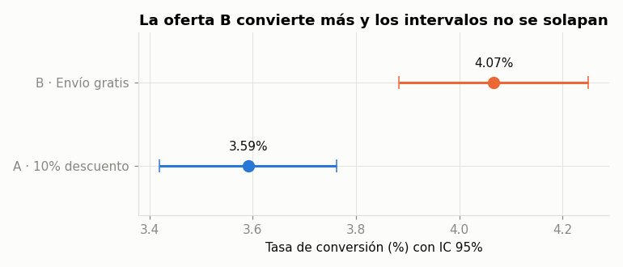
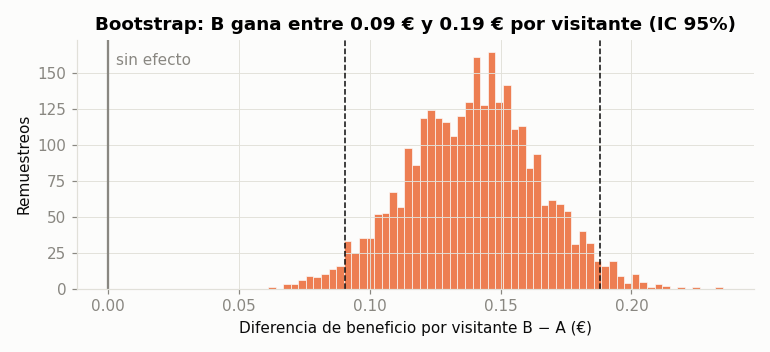
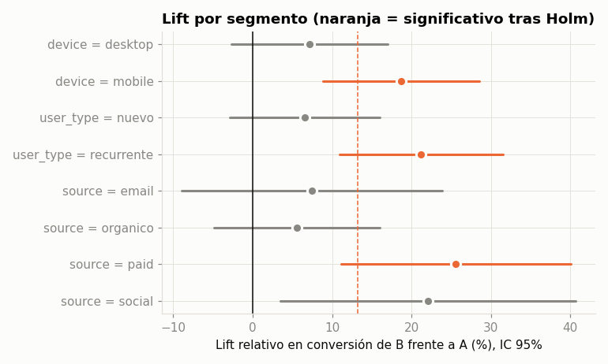

# Test A/B de ofertas en e-commerce: "10% de descuento" vs "Envío gratis"

Análisis completo de un experimento A/B para decidir qué oferta mostrar en la página de producto de una tienda online,
desde el diseño (tamaño muestral) hasta la recomendación de negocio, combinando estadística **frecuentista** y **bayesiana**.

| Variante | Oferta |
|---|---|
| **A** (control) | 10% de descuento en el pedido |
| **B** (tratamiento) | Envío gratis en pedidos ≥ 40 € |

## Resultado principal

| Métrica | A | B | Lift | Significativo |
|---|---|---|---|---|
| Tasa de conversión | 3,59% | 4,07% | **+13,2%** | Sí (p = 0,0002) |
| Ingreso por visitante | 1,69 € | 2,11 € | **+24,8%** | Sí (p < 0,001) |
| Beneficio por visitante | 0,56 € | 0,70 € | **+24,8%** | Sí (p < 0,001) |
| Ticket medio | 46,99 € | 51,79 € | **+10,2%** | Sí (p < 0,001) |

- **P(B > A) = 99,99%** según el modelo bayesiano Beta-Binomial.
- Impacto estimado: **+13.400 €/mes de beneficio** (IC 95%: +8.700 € a +18.000 €).
- El efecto se concentra en **móvil** (+19%); en escritorio no es concluyente.

**Recomendación:** lanzar la oferta de envío gratis. Aunque la tienda asume el coste del envío, los clientes añaden productos
para llegar a los 40 € y el beneficio por visitante sube un 25%.





## Qué incluye el análisis

1. **Diseño del experimento**: cálculo del tamaño muestral a partir del efecto mínimo detectable (MDE), α y potencia.
2. **Sanity checks**: test de *Sample Ratio Mismatch* (SRM) y balance de covariables entre grupos.
3. **Métrica principal**: z-test de dos proporciones con intervalo de confianza de la diferencia.
4. **Métricas secundarias**: t-test de Welch e intervalos **bootstrap** para métricas muy asimétricas (ingreso y beneficio por visitante).
5. **Enfoque bayesiano**: probabilidad de que B supere a A y pérdida esperada de cada decisión.
6. **Segmentos**: análisis por dispositivo, tipo de usuario y canal con corrección **Holm-Bonferroni** por comparaciones múltiples.
7. **Evolución temporal**: conversión acumulada y por qué no hay que parar el test antes de tiempo (*peeking*).
8. **Impacto de negocio** y recomendación.

👉 El análisis completo, explicado paso a paso, está en [`notebooks/analisis_ab_test.ipynb`](notebooks/analisis_ab_test.ipynb).

## Datos

Los datos son **simulados** con [`src/generate_data.py`](src/generate_data.py) (90.000 visitantes, 28 días) a partir de un modelo
con un efecto real conocido. Esto permite **validar el método**: el análisis recupera el efecto que se introdujo
(lift fuerte en móvil, débil en escritorio) y además muestra cómo el troceo por segmentos puede generar falsos positivos.

Cada fila es un visitante:

| Columna | Descripción |
|---|---|
| `user_id`, `date` | Identificador y día de la visita |
| `variant` | Variante asignada (A / B) |
| `device`, `user_type`, `source` | Dispositivo, nuevo/recurrente y canal de adquisición |
| `converted` | 1 si compró |
| `revenue` | Ingreso por productos (con el descuento aplicado en A) |
| `profit` | Ingreso − coste del producto − envío asumido por la tienda |

## Estructura

```
├── data/experiment_data.csv        # Dataset del experimento
├── notebooks/analisis_ab_test.ipynb # Análisis completo y conclusiones
├── reports/figures/                 # Gráficos generados
├── src/
│   ├── generate_data.py             # Simulación del experimento
│   └── ab_stats.py                  # Funciones estadísticas reutilizables
└── tests/test_ab_stats.py           # Tests unitarios de las funciones estadísticas
```

## Cómo ejecutarlo

```bash
pip install -r requirements.txt
python src/generate_data.py       # regenera los datos (opcional, ya están incluidos)
pytest tests                      # comprueba las funciones estadísticas
jupyter notebook notebooks/analisis_ab_test.ipynb
```

## Tecnologías

Python · pandas · NumPy · SciPy · Matplotlib · Jupyter · pytest
