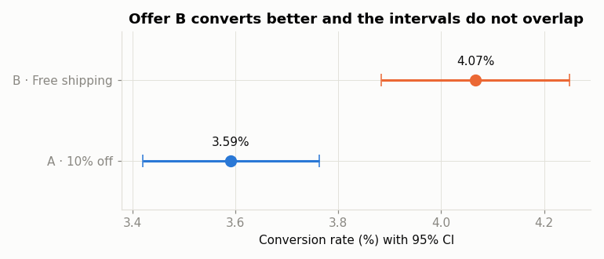
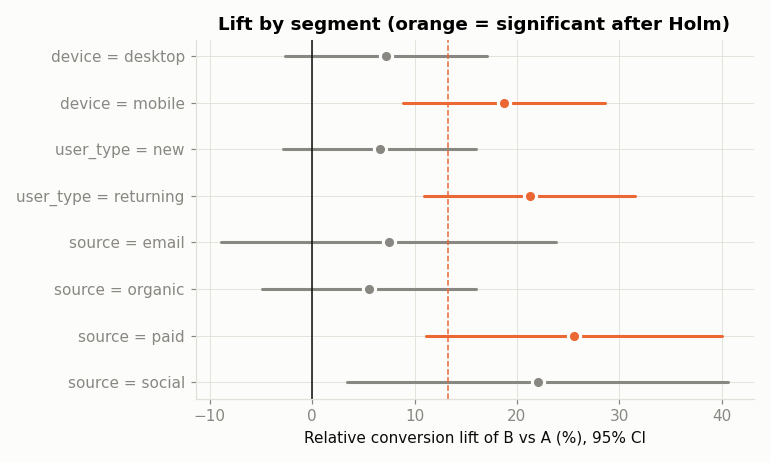
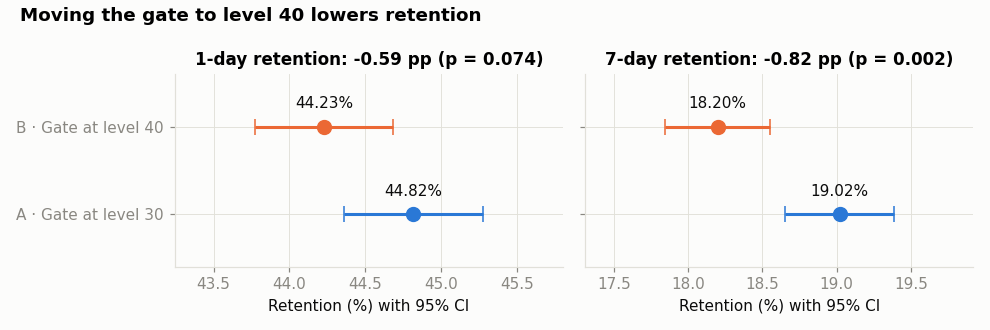

# A/B Test: Free Shipping vs 10% Discount in E-commerce

End-to-end analysis of an A/B experiment to decide which offer to show on an online store's product page, from experiment
design (sample size) to a business recommendation, combining **frequentist** and **Bayesian** statistics.

| Variant | Offer |
|---|---|
| **A** (control) | 10% off the order |
| **B** (treatment) | Free shipping on orders ≥ €40 |

## Key results

| Metric | A | B | Lift | Significant |
|---|---|---|---|---|
| Conversion rate | 3.59% | 4.07% | **+13.2%** | Yes (p = 0.0002) |
| Revenue per visitor | €1.69 | €2.11 | **+24.8%** | Yes (p < 0.001) |
| Profit per visitor | €0.56 | €0.70 | **+24.8%** | Yes (p < 0.001) |
| Average order value | €46.99 | €51.79 | **+10.2%** | Yes (p < 0.001) |

- **P(B > A) = 99.99%** under a Beta-Binomial Bayesian model.
- Estimated impact: **+€13,400/month in profit** (95% CI: +€8,700 to +€18,000).
- The effect is concentrated on **mobile** (+19%); inconclusive on desktop.

**Recommendation:** roll out free shipping. Even though the store absorbs the shipping cost, customers add items to reach
the €40 threshold and profit per visitor rises by 25%.





## Guardrail metrics

A winning offer must not break something else. **Shipping cost per order** is checked through profit per visitor, which nets it out
(it goes up, so the guardrail holds). **Return rate** and **cancelled orders** are monitored for 30 days after launch, since free
shipping can drive customers to add items just to reach €40 and send them back; checkout **latency and errors** must not increase.

## Real-data case: Cookie Cats retention

The main analysis uses simulated data, so the same toolkit (`src/ab_stats.py`) is also applied to a **real experiment**: the
public *Cookie Cats* mobile-game dataset (90,189 players), where the first gate (a forced wait-or-pay break) was moved from
**level 30 to level 40**. It is the same decision as moving a paywall or free-tier limit: where should the first friction go
to protect **activation and retention**?

| Metric | Gate 30 (A) | Gate 40 (B) | Difference | Significant |
|---|---|---|---|---|
| 1-day retention (activation) | 44.82% | 44.23% | −0.59 pp | No (p = 0.074) |
| **7-day retention** (primary) | 19.02% | 18.20% | **−0.82 pp (−4.3%)** | Yes (p = 0.002, Holm 0.003) |
| Median rounds played (14 days) | 17 | 16 | −1 | No gain |

- **P(gate 40 > gate 30) = 0.08%** for 7-day retention; bootstrap and z-test CIs agree ([−1.33, −0.31] pp).
- `sum_gamerounds` is heavy-tailed: **one player with 49,854 rounds** accounts for the whole difference in means, so
  engagement is compared with the median, a trimmed mean and Mann-Whitney instead.
- SRM p = 0.009: above the 0.001 alarm, but flagged for a logging check.

**Recommendation:** keep the gate at level 30. Moving it costs ~820 day-7 players per 100,000 installs with no engagement gain.
Full analysis: [`notebooks/cookie_cats_retention.ipynb`](notebooks/cookie_cats_retention.ipynb).



## What the analysis covers

1. **Experiment design**: sample size from the minimum detectable effect (MDE), α and power.
2. **Sanity checks**: *Sample Ratio Mismatch* (SRM) test and covariate balance between groups.
3. **Guardrail metrics**: what must not get worse for the launch to go ahead.
4. **Primary metric**: two-proportion z-test with a confidence interval for the difference.
5. **Secondary metrics**: Welch's t-test and **bootstrap** intervals for highly skewed metrics (revenue and profit per visitor).
6. **Bayesian approach**: probability that B beats A and expected loss of each decision.
7. **Segments**: by device, user type and channel, with **Holm-Bonferroni** correction for multiple comparisons.
8. **Evolution over time**: cumulative conversion and why a test should not be stopped early (*peeking*).
9. **Business impact** and recommendation.

👉 The full, step-by-step analysis is in [`notebooks/ab_test_analysis.ipynb`](notebooks/ab_test_analysis.ipynb).
Methodological choices (Holm vs Bonferroni, expected loss, when to stop a test, CUPED…) are explained in [`docs/METHODOLOGY.md`](docs/METHODOLOGY.md).

## Data

The data is **simulated** with [`src/generate_data.py`](src/generate_data.py) (90,000 visitors, 28 days) from a model with a
known true effect. This makes it possible to **validate the method**: the analysis recovers the effect that was introduced
(strong lift on mobile, weak on desktop) and also shows how slicing by segments can produce false positives.

Each row is a visitor:

| Column | Description |
|---|---|
| `user_id`, `date` | Visitor ID and day of the visit |
| `variant` | Assigned variant (A / B) |
| `device`, `user_type`, `source` | Device, new/returning user and acquisition channel |
| `converted` | 1 if they purchased |
| `revenue` | Product revenue (with the discount applied in A) |
| `profit` | Revenue − product cost − shipping absorbed by the store |

## Project structure

```
├── data/
│   ├── experiment_data.csv           # Simulated experiment dataset
│   └── cookie_cats/cookie_cats.csv   # Real Cookie Cats dataset (public)
├── docs/METHODOLOGY.md               # Methodological choices explained
├── notebooks/
│   ├── ab_test_analysis.ipynb        # Full analysis and conclusions
│   └── cookie_cats_retention.ipynb   # Real-data retention case
├── reports/figures/                  # Generated charts
├── src/
│   ├── generate_data.py              # Experiment simulation
│   └── ab_stats.py                   # Reusable statistical functions
└── tests/test_ab_stats.py            # Unit tests for the statistical functions
```

## How to run it

```bash
git clone https://github.com/imartinsorribes/ab-test-free-shipping-vs-discount.git
cd ab-test-free-shipping-vs-discount
pip install -r requirements.txt
python src/generate_data.py       # regenerates the data (optional, already included)
pytest tests                      # tests the statistical functions
jupyter notebook notebooks/ab_test_analysis.ipynb
jupyter notebook notebooks/cookie_cats_retention.ipynb
```

The Cookie Cats CSV comes from the public *Mobile Games A/B Testing with Cookie Cats* dataset (DataCamp / Kaggle), via the
mirror at [robguilarr/ab_testing_cookie_cats](https://github.com/robguilarr/ab_testing_cookie_cats).

## Tech stack

Python · pandas · NumPy · SciPy · Matplotlib · Jupyter · pytest
